# The Link — a sound card as a graphics coprocessor

**The Link** (invdemo, 2009) by **Alone Coder** — code and music; graphics by Alone Coder,
**Oimidrol** and **Shiru** — is a ZX Spectrum demo for a **Pentagon 1024** with a **NeoGS**
sound card. It is the only known demo that uses the NeoGS as a compute accelerator: the card's own Z80,
at 24 MHz with megabytes of RAM, draws every picture — tunnels, rotations, textured 3D — and the
Spectrum reads each finished picture out of the card's memory as if it were its own ROM, through
the card's ZX-DMA. The card plays no sound at all; the music is on the Spectrum's TurboSound FM.

This repository rebuilds the demo **from source**, byte for byte, with one command on macOS,
Linux and Windows, and explains how every part of it works.

| 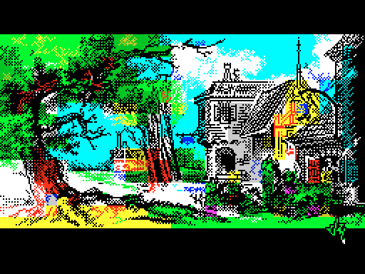 | 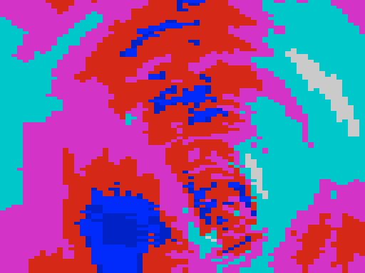 | 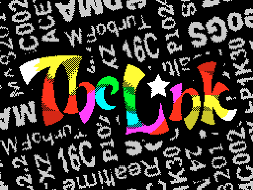 | 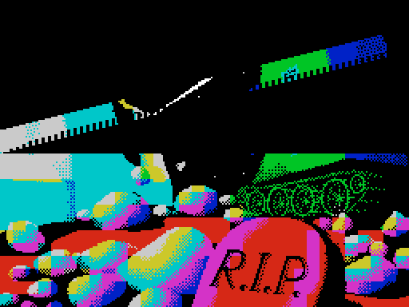 |
|:---:|:---:|:---:|:---:|
| intro | [tunnel](docs/tutorial/04-tunnel.md) | [rotator](docs/tutorial/05-rotator.md) | [rotating bars](docs/tutorial/06-rotating-bars.md) |
| 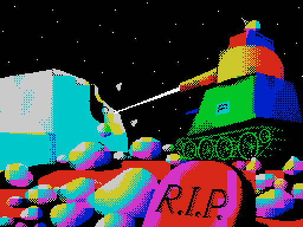 |  | 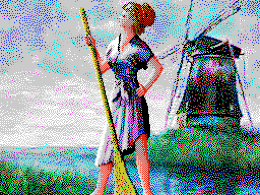 | 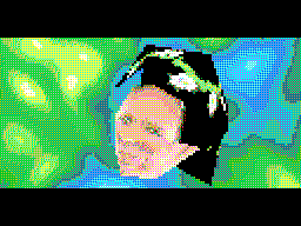 |
| [multi-bars](docs/tutorial/07-multi-bars.md) | [hedgehog](docs/tutorial/08-hedgehog.md) | [girl and mill](docs/tutorial/09-girl-and-mill.md) | [textured face](docs/tutorial/10-textured-face.md) |

## Run it

Two disks, [`release/`](release/README.md):

| | |
|---|---|
| [`TheLink-NonDirectorsCut.scl`](release/TheLink-NonDirectorsCut.scl) | **Non-Director's Cut** — the finished release this repository builds: boots straight into the demo, checks the machine, loads under a title picture with a progress bar. Insert it, `RUN` (or Enter in the TR-DOS menu) |
| [`TheLink.trd`](release/TheLink.trd) | **the original, unfinished** — the author's working disk as found: `RUN "THELINK"` assembles the demo with ALASM at every start, checks nothing, and on the wrong machine hangs without a word |

Both need

- a **Pentagon 1024** (1024K paging through `#7FFD` bits 5-7 and `#EFF7`), and
- a **NeoGS** card (ZX-DMA; a classic General Sound has none).

While it loads, a bar under the title fills one segment per RAM page; if a file is missing, the
bar gives way to a message saying which. On the wrong machine it says what it found instead of
hanging:

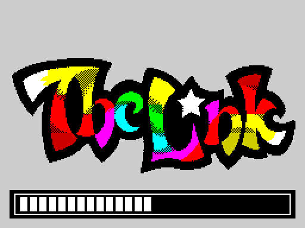 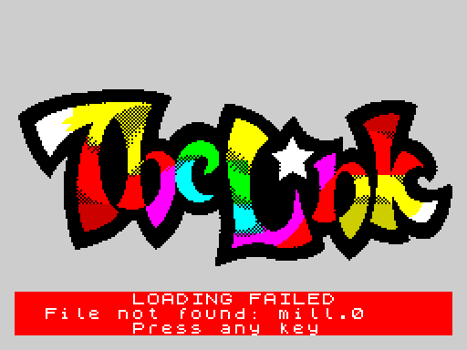

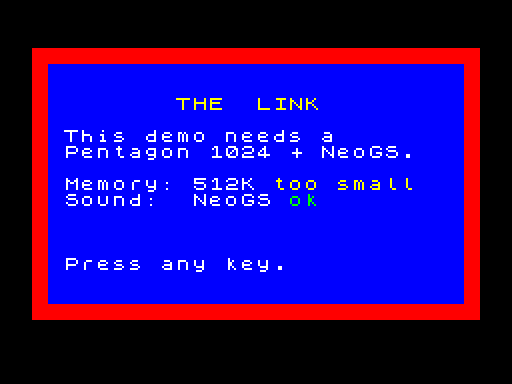 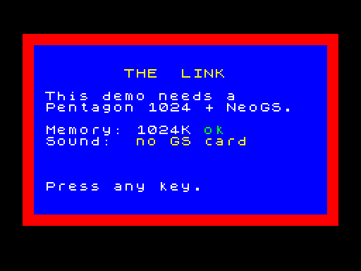

Real hardware: a Pentagon 1024SL with a NeoGS. Emulators: the demo is verified in
[unreal-ng](https://github.com/alfishe/unreal-ng) (its Pentagon configuration has both); an
emulator needs Pentagon 1024 paging, the NeoGS firmware and ZX-DMA in both directions
([docs/analysis.md](docs/analysis.md) section 7). The demo runs about two minutes and ends on its
credits.

## Build it

Nothing to install: the assembler, [sjasmplus](https://github.com/z00m128/sjasmplus) 1.23.1, is
in [`tools/sjasmplus/`](tools/sjasmplus/README.md) for macOS (universal), Linux (x64, arm64) and
Windows (x64).

| | |
|---|---|
| macOS, Linux | `./build.sh` |
| Windows | `build.cmd` |

```
The Link: demo, SjASMPlus Z80 Cross-Assembler v1.23.1
  tools/tables.asm            ok
  src/GSTUNNE4.asm            ok
  ...
  src/THELINK.asm             ok
  src/loader/loader.asm           ok
  tools/release.asm           ok
    TheLink-NonDirectorsCut.scl: 33 files, 1173 sectors, loader #6000..#65C4, main block #7800..#B154
    TheLink-NonDirectorsCut.scl: the published disk, byte for byte (sha256 5102376b...)
```

The output is `build/TheLink-NonDirectorsCut.scl`, the Non-Director's Cut, with a listing (`build/obj/*.lst`) of
every source. Every build checks the four tables, the 19 effect objects and the main block
against the SHA-256 of the author's own files, and the disk against the published one; any
difference, error or assembler warning stops it.

| Target | |
|---|---|
| `demo` (default) | the demo from source |
| `experiment` | the same from changed sources: differences are reported, the disk is written anyway — change something, build, boot, see |
| `stage1`, `stage2` | the [intermediate builds](materials/02-addons/README.md): a plain loader; the loader with the machine check |
| `clean` | remove `build/` |

`VERBOSE=1` shows what the sources print while they assemble (the author's sizes and addresses).
CI builds all targets on the four platforms ([`.github/workflows/build.yml`](.github/workflows/build.yml)).

## How it works, in one picture

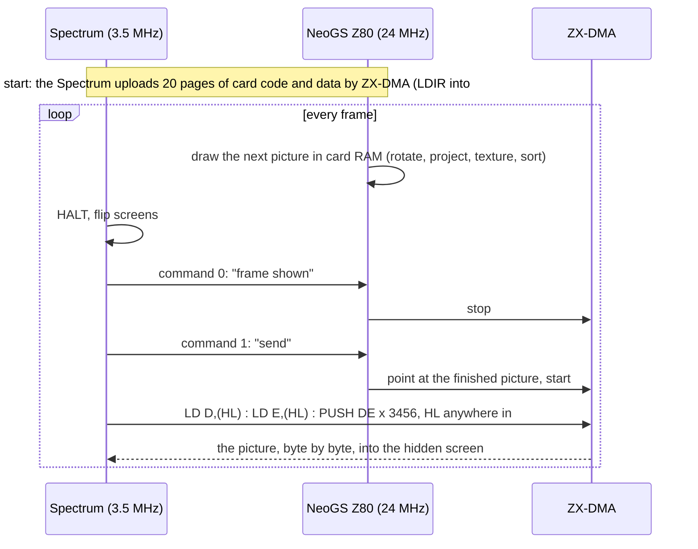

The Spectrum reads its ROM area; the card answers every read with the next byte of the picture
it has drawn. 6,912 bytes cross in a little over a frame, while the card is already drawing the
next one. [Chapter 3](docs/tutorial/03-the-frame.md) takes this apart; each effect chapter shows
what the card computes and how the Spectrum puts it on screen.

## Learn

The short version — the whole idea on one page, in the ZX Spectrum knowledge base:
**[Case study: "The Link" — a sound card used as a graphics coprocessor](https://github.com/alfishe/speccy-bootcamp/blob/main/07_demoscene/thelink_case_study.md)**
(ZX-DMA, the frame handshake, the interrupt-safe blits, the pitfalls, what an emulator must do).

The long version, the [tutorial](docs/tutorial/README.md), for readers who know Z80 assembler and the Spectrum 128:

| # | Chapter | |
|---|---|---|
| 1 | [The machine](docs/tutorial/01-the-machine.md) | Pentagon 1024 paging and 16-colour mode; the NeoGS: its CPU, memory, mailbox, ZX-DMA |
| 2 | [The start](docs/tutorial/02-the-start.md) | `GO`: the card program, the upload of 20 pages, the resident loop, the timeline, music, credits |
| 3 | [The frame](docs/tutorial/03-the-frame.md) | the handshake every effect repeats; DMA reads, `PUSH` blits, an interrupt handler that survives `SP` writing into the screen |
| 4 | [Tunnel](docs/tutorial/04-tunnel.md) | a lookup-table tunnel in the attributes; code generated on the card |
| 5 | [Rotator](docs/tutorial/05-rotator.md) | a rotating, scrolling logo: 16 pre-rotated copies, generated line code |
| 6 | [Rotating bars](docs/tutorial/06-rotating-bars.md) | bars swinging about their corners, rasterised on the card into lists the Spectrum plots |
| 7 | [Multi-bars](docs/tutorial/07-multi-bars.md) | the card writes a program for the Spectrum every frame, timed to the T-state |
| 8 | [Hedgehog](docs/tutorial/08-hedgehog.md) | a lit, textured 3D object: rotation by tables, projection, sorting, chunky-to-planar |
| 9 | [Girl and mill](docs/tutorial/09-girl-and-mill.md) | two masked 16-colour layers scrolling at different speeds |
| 10 | [Textured face](docs/tutorial/10-textured-face.md) | the texture mapper in depth: self-patching scanline code, culling by an opcode byte |
| 11 | [Building it](docs/tutorial/11-building-it.md) | from the author's ALASM disk to this project |

More: [docs/analysis.md](docs/analysis.md) (the author's disk and how the demo starts there),
[docs/loader.md](docs/loader.md) (the release loader and the memory image at `GO`),
[docs/conversion.md](docs/conversion.md) (ALASM to sjasmplus). Every source in `src/` starts with
an English header and carries English notes next to the author's Russian comments.

## Repository map

```
build.sh, build.cmd   build the demo (macOS / Linux, Windows)
src/                  the sources the demo is built from          <- read and change these
  data/               pictures, textures, palettes, models, music the sources INCBIN
  loader/             the release loader
tools/                what builds it: sjasmplus for every platform, the Lua build steps
release/              the disk images the build reproduces         <- run these
docs/                 the tutorial, the analyses, the screenshots  <- learn here
materials/            what the project started from and went through
  01-original/        the author's working disk, his ALASM sources and BASIC programs
  02-addons/          the intermediate builds and the first release
```

| Path | |
|---|---|
| [`src/`](src/README.md) | the 20 sources, converted from ALASM to sjasmplus and annotated: seven effect units, the main module `THELINK.asm`, shared includes, the author's tools kept as he left them |
| [`src/data/`](src/data/README.md) | what the sources `INCBIN` and no source makes, from the author's disk, unchanged |
| [`src/loader/`](src/loader/README.md) | the release loader: machine check, error screen, loading by name |
| [`tools/`](tools/README.md) | the build steps ([`tables.asm`](tools/tables.asm), [`release.asm`](tools/release.asm), their [Lua](tools/lua/thelink.lua)), the vendored [sjasmplus](tools/sjasmplus/README.md), an optional extractor |
| [`release/`](release/README.md) | `TheLink-NonDirectorsCut.scl`, the Non-Director's Cut; `TheLink.trd`, the original |
| [`docs/`](docs/README.md) | the [tutorial](docs/tutorial/README.md) in eleven chapters, [analysis](docs/analysis.md), [loader](docs/loader.md), [conversion](docs/conversion.md), [screenshots](docs/images/) |
| [`materials/`](materials/README.md) | [`01-original/`](materials/01-original/README.md): the author's working disk `TheLink.trd`, its ALASM sources and BASIC programs as text; [`02-addons/`](materials/02-addons/README.md): stage 1 (a plain loader), stage 2 (the machine check), the first release build |

## Where it comes from

The author never released a disk of The Link: what survived is his **working disk** — ALASM, the
STS debugger, every source and every binary, and a launcher that assembles the demo each time it
starts. The project behind this repository took that disk apart in the
[unreal-ng](https://github.com/alfishe/unreal-ng) emulator, replaced the assembler start with a
loader, added a machine check, then converted all 20 sources to sjasmplus with unreal-ng's
assembler library (unreal-asm) and rebuilt everything from them — down to the four tables the
author computed in Sinclair BASIC. Each step was checked byte for byte against the author's
files; [docs/tutorial/11-building-it.md](docs/tutorial/11-building-it.md) tells the story, and
the steps are kept in [`materials/02-addons/`](materials/02-addons/README.md).

## Credits and license

The Link © 2009 Alone Coder (code, music), Oimidrol, Shiru (graphics) — all rights to the demo
remain with its authors. The build, the loader, the annotations and the documentation of this
repository are MIT-licensed; sjasmplus is BSD-licensed. Details: [LICENSE.md](LICENSE.md).
