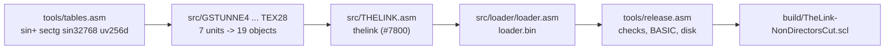

# tools — everything that builds the demo

Nothing here needs installing. The assembler is vendored for every platform, and every other build
step is Lua that the assembler itself runs: no Python, no make, no shell utilities beyond the two
launch scripts.

| Tool | Kind | What it does | Who runs it |
|---|---|---|---|
| [`../build.sh`](../build.sh), [`../build.cmd`](../build.cmd) | shell / cmd script | the whole build, in order, for macOS + Linux / Windows | you |
| [`sjasmplus/`](sjasmplus/README.md) | Z80 assembler, binaries | assembles every source; runs the Lua of the steps below | the build scripts |
| [`tables.asm`](tables.asm) | sjasmplus source with Lua | step 1: the four tables the author computed in Sinclair BASIC | the build scripts |
| [`release.asm`](release.asm) | sjasmplus source with Lua | last step: the checks, the BASIC programs, the disk image | the build scripts |
| [`lua/thelink.lua`](lua/thelink.lua) | Lua module | the code both steps use | `tables.asm`, `release.asm` |
| [`sjasmplus/build-sjasmplus.sh`](sjasmplus/build-sjasmplus.sh) | shell script | rebuilds the vendored binaries from the upstream release | a maintainer, rarely |
| [`extract_thelink.py`](extract_thelink.py) | Python 3 script, optional | the author's sources and BASIC programs out of his disk image, as text | a maintainer, once |

## The build scripts — `build.sh`, `build.cmd`

In the repository root. Both do the same: they pick the sjasmplus binary for the machine, create
`build/obj/`, assemble each step there and stop at the first error or warning.

```
./build.sh [target]          build.cmd [target]
```

| Target | Result |
|---|---|
| `demo` (default) | `build/TheLink-NonDirectorsCut.scl`, the Non-Director's Cut, checked byte for byte |
| `experiment` | the same from changed sources: differences from the author's files are printed, the disk is written anyway |
| `stage1`, `stage2` | the [intermediate builds](../materials/02-addons/README.md) |
| `clean` | removes `build/` |

| Variable | |
|---|---|
| `SJASMPLUS=/path/to/sjasmplus` | use another sjasmplus (1.23 or later, built with Lua) instead of the vendored one |
| `VERBOSE=1` | also show what the sources print while they assemble (`DISPLAY`: the author's sizes and addresses) |

The order of a `demo` build, all in `build/obj/` (every source also leaves its listing `<name>.lst`
and its messages `<name>.log` there):



`stage1` / `stage2` assemble `materials/02-addons/stageN-*/thelink_main.asm` and the stage's
`loader.asm` instead, then `release.asm` with `-DSTAGE=N`.

## sjasmplus — the assembler

[sjasmplus](https://github.com/z00m128/sjasmplus) 1.23.1, built with its Lua 5.5, for macOS
(universal), Linux (x64, arm64, static) and Windows (x64). Which binary, how each was built, their
hashes and the license: [sjasmplus/README.md](sjasmplus/README.md).

`build-sjasmplus.sh [all|macos|linux-x64|linux-arm64|windows-x64]` rebuilds them from the
upstream tag (macOS with the Xcode tools; Linux and Windows in Docker: Alpine for static musl
binaries, MinGW-w64 for Windows). `SJASMPLUS_TAG` and `SJASMPLUS_REPO` pick another tag or
repository.

## tables.asm — the author's tables

The author made four tables by running BASIC programs on the Spectrum and saving the memory they
POKEd ([materials/01-original/basic/](../materials/01-original/basic/)). This step computes them
again, the same way, and writes them to `build/obj/` for the effect sources to `INCBIN`:

| Table | Bytes | BASIC | Used by |
|---|---|---|---|
| `sin+` | 256 | `sin+.bas`: 127·SIN at the middle of each of 256 steps | rotating bars, textured face |
| `sectg` | 256 | `sectg.bas`: 128/COS a and 256·TAN a, a in 0..π/4 | rotating bars |
| `sin32768` | 512 | `sin32768.bas`: 32768·SIN as words, low bytes then high bytes | rotator |
| `uv256d` | 4096 | `uv256d.bas`: the u,v texture offsets of a 64 x 32 quarter screen | textured face |

The values come out as the author's because the rounding is Sinclair BASIC's: `POKE` and
`RANDOMIZE` store the nearest integer of the magnitude with the sign kept, `INT(x+.5)` rounds up at
.5. One entry differs from the bare formula: `sin32768` at 90° is `#7FFF` on the author's disk,
not `#8000` — +32768 does not fit a signed word, and the table holds the signed maximum there.
`release.asm` checks all four against the author's files.

## release.asm — checks and the disk

The last step, in four parts:

1. **No warnings.** It reads the `<name>.log` of every assembly of the build and stops at any
   line with "warning" (so the check is the same on every system).
2. **The author's bytes.** It computes the SHA-256 of the four tables, of the 19 effect objects
   (`TUNNELZX` ... `TEXGS`) and of the main block `thelink` (`#7800`-`#B154`, 14,677 bytes) and
   compares each with the hash of the author's own file. The main block's length must also match
   the loader's `MAIN_END`.
3. **The disk.** It writes the two BASIC programs (`boot`: `RUN "THELINK"`; `THELINK`:
   `CLEAR 24575`, `LOAD "loader" CODE`, `RANDOMIZE USR 24576`) and `build/TheLink-NonDirectorsCut.scl` with
   `boot`, `THELINK`, `loader`, the title `thelink$`, `thelink` and the 28 page files in the
   order of the loader's table ([release/README.md](../release/README.md)).
4. **The published disk.** It compares the SHA-256 of the SCL with the published one
   (`53dd7ad7...` for the demo; each stage has its own).

| Define | |
|---|---|
| `-DEXPERIMENT=1` | parts 2 and 4 print a difference instead of stopping (`./build.sh experiment`) |
| `-DSTAGE=1`, `-DSTAGE=2` | checks only the hand-ported main block (`thelink_main.bin`); the page files come straight from the author's disk image instead of the build |

## lua/thelink.lua — the Lua both steps use

Loaded with `INCLUDELUA`; it defines the global table `TheLink`. Paths are relative to the folder
sjasmplus runs in (`build/obj/`).

| Function | |
|---|---|
| `read(path)`, `write(path, data)` | whole files as Lua strings |
| `fail(message)` | reports an sjasmplus error for the line and stops |
| `sin_plus()`, `sectg()`, `sin32768()`, `uv256d()`; `tables` | the four tables, and the list `tables.asm` writes |
| `sha256(data)` | SHA-256 as 64 hex digits, in plain Lua |
| `read_trd(path)`, `find(files, name, type)` | the files of a TR-DOS disk image (name, type, start, length, data) |
| `scl(entries)` | an SCL image of files `{name, type, start, length, body}`, with its checksum |
| `basic_line(number, parts)`, `basic_file(name, lines, autostart)` | a tokenized BASIC line, and a TR-DOS BASIC file with its autostart line |

## extract_thelink.py — the sources out of the disk image

Optional (Python 3, standard library): the build does not use it. It reads the author's disk
image and writes his sources as text — this is how
[materials/01-original/alasm/](../materials/01-original/alasm/) and
[materials/01-original/basic/](../materials/01-original/basic/) were made.

```
python3 tools/extract_thelink.py materials/01-original/TheLink.trd materials/01-original [--raw]
```

- `alasm/<name>.asm`: every ALASM source (TR-DOS type `H`) detokenized to UTF-8 text, the Russian
  comments converted from code page 866. The script's header documents ALASM's tokenized format.
- `basic/<name>.bas`: every BASIC program as a listing.
- `--raw`: also every file of the disk, raw, in `raw/` (for analysis; not kept in the repository).
- On standard output: the disk's catalog as a table.

The conversion from these ALASM sources to the sjasmplus ones in `src/` was made with another
tool, unreal-asm's `zxasm`, once: [docs/conversion.md](../docs/conversion.md).
